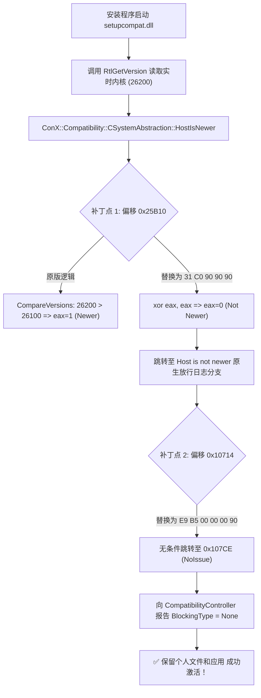

# Win11 Bypass HostIsNewer Upgrade

[](https://opensource.org/licenses/MIT)
[](https://www.microsoft.com/software-download/windows11)
[]()

> **Bypass the Windows 11 In-place Upgrade "Host Is Newer" Hard Block (`Setup_HostIsNewer: HardBlock`) to keep all personal files, applications, and settings when performing cross-build downgrade or repair installs without clean installing.**
>
> **解决 Windows 11 跨版本/降级覆盖安装时“无法保留个人文件和应用”的硬性阻断工具与逆向解析方案。**

---

## 📌 背景与核心问题 (Problem Statement)

当用户尝试使用 Windows 11 安装介质（ISO 镜像）对当前系统进行就地升级（In-place Upgrade / 覆盖安装）时，经常会遇到以下弹窗警告，且 **“保留个人文件和应用”** 选项被完全置灰锁死：

> ❌ **“无法保留你的文件、应用和设置，因为你当前的Windows版本可能安装在不受支持的目录中，或者你正在尝试安装更旧版本的Windows。”**

### 为什么网上流传的“修改注册表”方法会失效？
许多网上教程建议通过修改注册表 `HKLM\SOFTWARE\Microsoft\Windows NT\CurrentVersion` 中的 `CurrentBuild` 和 `EditionID` 来欺骗安装程序。但在以下常见场景中，该方法会 **完全失效**：
1. 当前系统安装了预览体验累积更新包（如 **Build 26200+**，或定制系统如 ReviOS 预装补丁）；
2. 下载的官方/发布版 ISO 镜像内部实际构建版本低于当前系统内核（例如镜像内部为 **Build 26100**）；
3. 安装程序通过底层内核直接检测版本，而非仅仅依赖用户模式注册表。

---

## 🔬 逆向工程剖析 (Reverse Engineering Analysis)

通过对 Windows 安装检查器日志 `C:\$WINDOWS.~BT\Sources\Panther\setupact.log` 以及兼容性检测核心模块 `setupcompat.dll` 进行逆向反汇编分析：

### 1. 拦截日志定位
```text
CHostIsNewerChecker invoked.
pGetHostCSDBuildNumber: 'HKLM\SOFTWARE\Microsoft\Windows NT\CurrentVersion\CSDBuildNumber' does not exist. Assume 0
Host OS version: 10.0.26200.0  (0.0) Platform 0x2, SuiteMask 0x100, ProdType 0x1
Target OS version: 10.0.26100.9445
ConX::Compatibility::CSystemAbstraction::HostIsNewer: Host is newer than target.
CHostIsNewerChecker: checked HostIsNewer, found HardBlock.
```

### 2. 内核版本读取机制
`setupcompat.dll` 中的 `ConX::Setup::Common::COSInfoHelper::GetHostOSVersion`（文件偏移 `0x28EC`）直接调用了 `ntdll.dll!RtlGetVersion`：
```x86asm
0028D0: 48 8D 4C 24 70     lea  rcx, [rsp+70h]       ; OSVERSIONINFOEXW
0028E4: C7 44 24 70 1C 01  mov  dword ptr [rsp+70h], 11Ch
0028EC: FF 15 09 87 03 00  call qword ptr [RtlGetVersion]
0029E7: 8B 4C 24 74        mov  ecx, [rsp+74h]       ; dwMajorVersion (10)
0029F5: 41 89 0F           mov  [r15], ecx
002A00: 8B 4C 24 7C        mov  ecx, [rsp+7Ch]       ; dwBuildNumber (26200 from live kernel)
002A04: 41 89 4F 10        mov  [r15+10h], ecx
```
> **结论**：`RtlGetVersion` 直接从活动内核内存（`KUSER_SHARED_DATA`）读取宿主机版本号（26200）。即便修改了注册表 `CurrentBuild`，内存中的内核版本号依然高于镜像核心版本（26100），导致 `CHostIsNewerChecker` 判定 `Host > Target` 并触发 `HardBlock`。

### 3. 精准逻辑放行方案 (The Binary Bypass)



---

## 🛠️ 补丁明细 (Binary Patch Specifications)

| 模块 | 文件偏移 | 原始指令 (Original Bytes) | 替换补丁 (Patched Bytes) | 作用机制 |
| :--- | :--- | :--- | :--- | :--- |
| `setupcompat.dll` | **`0x25B10`** | `E8 EF D1 FD FF`<br/>(`call CompareVersions`) | `31 C0 90 90 90`<br/>(`xor eax, eax; nop; nop; nop`) | 将版本比对返回值强制置 0，使输出指针 `*pfHostIsNewer = 0`，走入原生“未更新”分支。 |
| `setupcompat.dll` | **`0x10714`** | `0F 84 B4 00 00 00`<br/>(`jz 0x107CE`) | `E9 B5 00 00 00 90`<br/>(`jmp 0x107CE; nop`) | 强制无条件跳转至 `NoIssue` 分支，彻底规避 `HardBlock` 判定。 |

---

## 🚀 使用方法 (Usage Guide)

### 步骤 1：解包 Windows 11 安装镜像
1. 将下载的 Windows 11 ISO 镜像挂载（例如挂载在 `E:\` 盘）。
2. 在本地磁盘（如 `D:\Win11Setup`）新建文件夹。
3. 将镜像内的所有文件完整复制到该文件夹中。

### 步骤 2：对 setupcompat.dll 实施旁路补丁
以管理员身份打开 PowerShell，运行本项目提供的自动修补脚本：
```powershell
powershell -ExecutionPolicy Bypass -File .\Patch-SetupCompat.ps1 -SetupPath "D:\Win11Setup"
```
脚本将自动：
* 备份原文件为 `setupcompat.dll.bak`；
* 批量清除只读属性；
* 校验特征码并精准写入放行补丁。

### 步骤 3：清理历史扫描缓存
清理系统旧有的拦截缓存记录，以确保安装程序进行全新的无阻断扫描：
```powershell
Remove-Item -Path "C:\$WINDOWS.~BT\Sources\Panther\Compat*" -Force -Recurse -ErrorAction SilentlyContinue
```

### 步骤 4：启动安装并保留所有内容
双击运行 `Start-Setup.bat`，或在命令行中执行：
```cmd
D:\Win11Setup\setup.exe /DynamicUpdate Disable
```
> **注意**：在安装程序弹出的“获取更新、驱动程序和可选功能”页面，请务必选择 **【不是现在】**，以确保安装程序直接使用本地修改后的无阻断模块。进入确认页面后即可看到 **“保留个人文件和应用”** 正常可选！

---

## 📂 项目结构 (Repository Structure)

```text
├── Patch-SetupCompat.ps1           # 核心一键二进制补丁脚本 (PowerShell)
├── Modify-Registry-Build26100.reg  # 注册表版本指纹对齐文件 (可选)
├── Restore-Registry-Build26200.reg # 注册表版本指纹还原文件 (可选)
├── Start-Setup.bat                 # 禁用动态更新的一键启动批处理
├── .gitignore                      # Git 忽略配置
├── LICENSE                         # MIT 开源许可证
└── README.md                       # 中英双语技术文档
```

---

## ⚠️ 免责声明 (Disclaimer)

本项目仅用于个人系统维护、灾难数据保留与系统逆向工程研究。请在执行跨版本系统升级前，务必对 C 盘个人核心重要数据进行完整备份。作者对因软硬件环境差异导致的任何意外数据丢失不承担法律责任。

---

## 📄 License
Released under the [MIT License](LICENSE).
Copyright (c) 2026 DDeeply.
